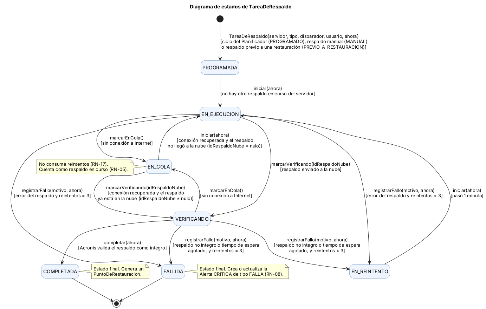
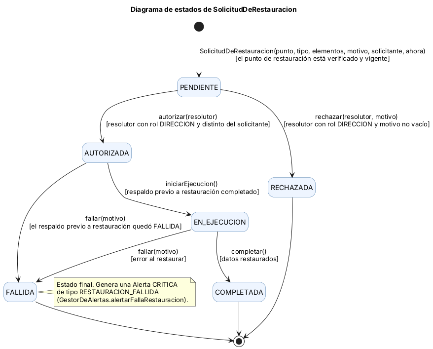
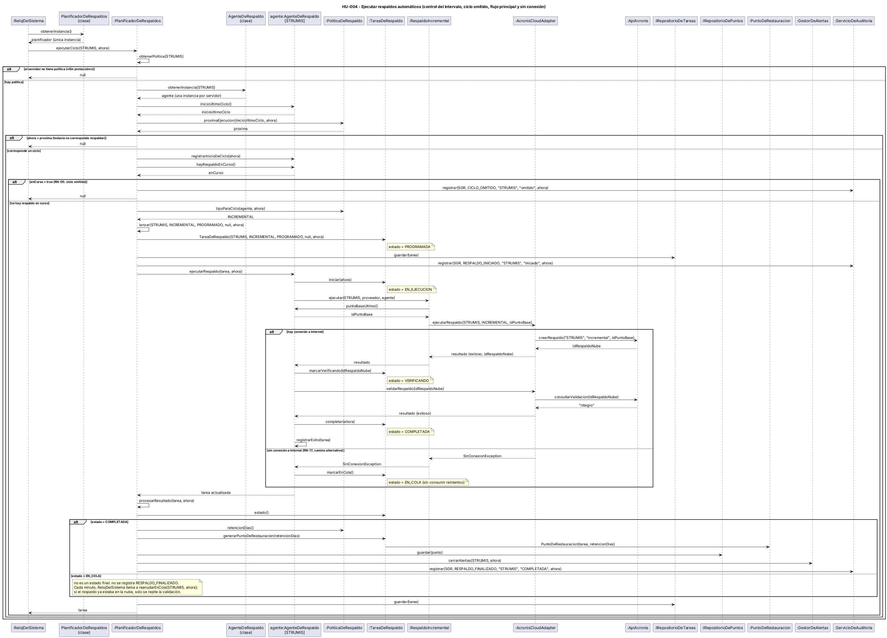
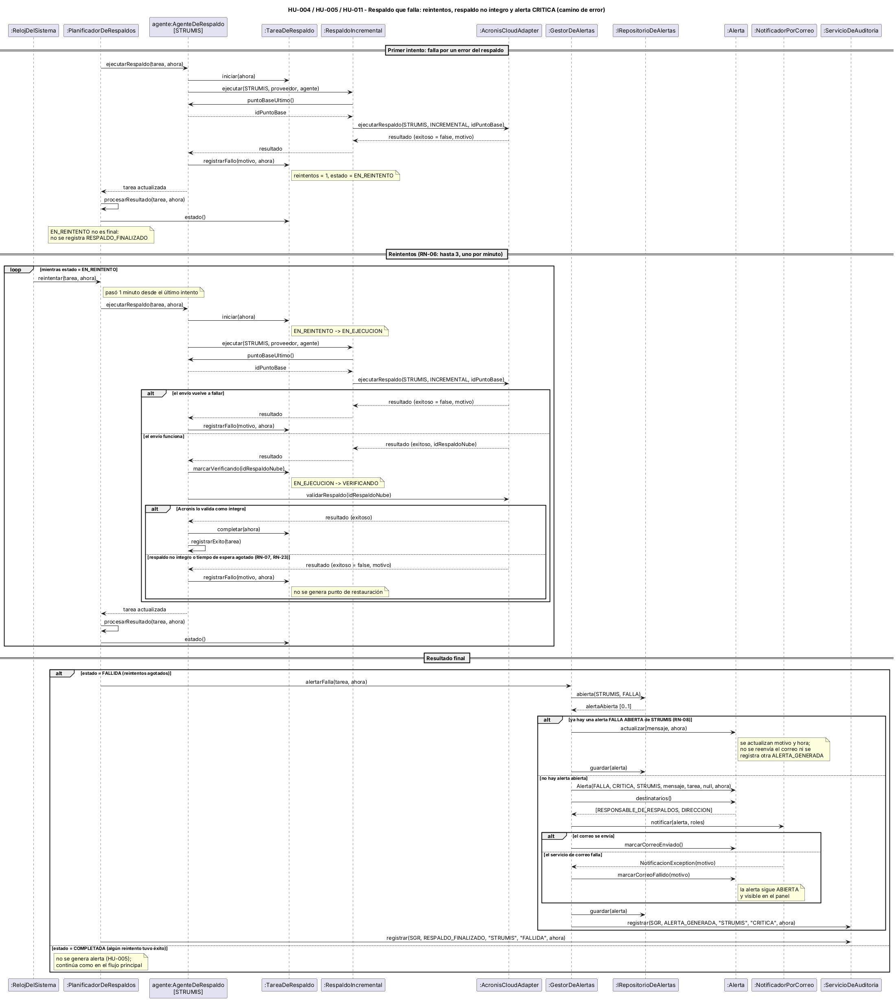

# 07 – Diagramas de estados y de secuencia

| | |
|---|---|
| **Entregable** | Punto 7 de la consigna (Parcial 2) |
| **Estado** | Versión final, corregida según la devolución – 04/11/2026 |
| **Base** | [06 – Diseño de clases](06-diseno-de-clases.md) y [00 – Documento maestro](00-documento-maestro.md) (estados y reglas) |
| **Fuentes de los diagramas** | [`07-estados-tarea.puml`](../diagramas/07-estados-tarea.puml), [`07-estados-solicitud.puml`](../diagramas/07-estados-solicitud.puml), [`07-secuencia-hu004.puml`](../diagramas/07-secuencia-hu004.puml) y [`07-secuencia-hu004-error.puml`](../diagramas/07-secuencia-hu004-error.puml) |

---

## 1. Diagrama de estados de la entidad central: `TareaDeRespaldo`

`TareaDeRespaldo` es la entidad central del caso: toda la operación del SGR (respaldos programados, manuales y previos a una restauración) pasa por una tarea. Sus estados son los de `EstadoDeTarea` (documento maestro, sección 12).

### Transiciones

Cada evento es un **método de `TareaDeRespaldo`** del diagrama de clases (vista 1).

| Origen | Destino | Evento (método) | Condición | Regla | Historias |
|---|---|---|---|---|---|
| (inicio) | PROGRAMADA | `TareaDeRespaldo(servidor, tipo, disparador, usuario, ahora)` | ciclo del Planificador (`PROGRAMADO`), respaldo manual (`MANUAL`) o respaldo previo a una restauración (`PREVIO_A_RESTAURACION`) | RN-05, RN-11 | HU-004, HU-006, HU-016 |
| PROGRAMADA | EN_EJECUCION | `iniciar(ahora)` | no hay otro respaldo en curso del servidor | RN-05 | HU-004 |
| EN_EJECUCION | VERIFICANDO | `marcarVerificando(idRespaldoNube)` | respaldo enviado a la nube | RN-07 | HU-004, HU-008 |
| VERIFICANDO | COMPLETADA | `completar(ahora)` | Acronis valida el respaldo como íntegro | RN-07 | HU-008 |
| EN_EJECUCION | EN_COLA | `marcarEnCola()` | sin conexión a Internet | RN-17 | HU-007 |
| VERIFICANDO | EN_COLA | `marcarEnCola()` | sin conexión a Internet | RN-17 | HU-007 |
| EN_COLA | EN_EJECUCION | `iniciar(ahora)` | conexión recuperada y el respaldo no llegó a la nube (`idRespaldoNube` = nulo) | RN-17 | HU-007 |
| EN_COLA | VERIFICANDO | `marcarVerificando(idRespaldoNube)` | conexión recuperada y el respaldo ya está en la nube (`idRespaldoNube` ≠ nulo): solo se repite la validación | RN-07, RN-17 | HU-004, HU-007 |
| EN_EJECUCION | EN_REINTENTO | `registrarFallo(motivo, ahora)` | error del respaldo y reintentos < 3 | RN-06 | HU-005 |
| VERIFICANDO | EN_REINTENTO | `registrarFallo(motivo, ahora)` | respaldo no íntegro o tiempo de espera de la validación agotado, y reintentos < 3 | RN-06, RN-07, RN-23 | HU-005, HU-008 |
| EN_REINTENTO | EN_EJECUCION | `iniciar(ahora)` | pasó 1 minuto | RN-06 | HU-005 |
| EN_EJECUCION | FALLIDA | `registrarFallo(motivo, ahora)` | error del respaldo y reintentos = 3 | RN-06 | HU-005, HU-011 |
| VERIFICANDO | FALLIDA | `registrarFallo(motivo, ahora)` | respaldo no íntegro o tiempo de espera agotado, y reintentos = 3 | RN-06, RN-07 | HU-005, HU-011 |
| COMPLETADA | (fin) | — | estado final: genera un `PuntoDeRestauracion` | RN-07, RN-12 | HU-008 |
| FALLIDA | (fin) | — | estado final: crea o actualiza la `Alerta` CRITICA de tipo FALLA | RN-08 | HU-011 |

**Estados finales:** `COMPLETADA` y `FALLIDA`. Una tarea final no cambia más; un nuevo ciclo crea otra tarea.

**Cómo se cuentan los reintentos.** `reintentos` cuenta los reintentos ya consumidos. `registrarFallo` **compara antes de sumar**: si `reintentos < MAX_REINTENTOS` (3), suma 1 y lleva la tarea a `EN_REINTENTO`; si ya es 3, la lleva a `FALLIDA` sin sumar. Así, el primer fallo deja `reintentos = 1` (como en HU-004 CA-4) y el cuarto fallo deja la tarea `FALLIDA` con `reintentos = 3`. Como cada reintento vuelve a ejecutar el respaldo, una tarea que nunca tiene éxito hace **4 intentos** en total, separados por 1 minuto (unos 3 minutos desde el primer fallo, menos que el intervalo mínimo de 5 minutos; SM-05).

**Falta de conexión.** Pasar a `EN_COLA` **no** consume reintentos (RN-17) y la tarea sigue contando como respaldo en curso (RN-05). Cada minuto, `RelojDelSistema` llama a `PlanificadorDeRespaldos.reanudarEnCola`: si vuelve la conexión, la tarea sigue por `EN_EJECUCION` (el respaldo no llegó a la nube) o directamente por `VERIFICANDO` (ya estaba en la nube).

**Un respaldo no íntegro** o un tiempo de espera agotado durante la validación (`VERIFICANDO`) se trata como cualquier error del respaldo: se reintenta y recién tras agotar los reintentos queda `FALLIDA`. En ningún caso genera un `PuntoDeRestauracion` (RN-07).

## 2. Diagrama de estados de `SolicitudDeRestauracion`

Se agrega este segundo diagrama porque el flujo de autorización (RN-10) también tiene un ciclo de vida propio.

| Origen | Destino | Evento (método) | Condición | Regla | Historias |
|---|---|---|---|---|---|
| (inicio) | PENDIENTE | `SolicitudDeRestauracion(punto, tipo, elementos, motivo, solicitante, ahora)` | el punto de restauración está verificado y vigente, y el servidor no tiene otra solicitud PENDIENTE | RN-10, RN-12, RN-22 | HU-014 |
| PENDIENTE | AUTORIZADA | `autorizar(resolutor)` | resolutor con rol `DIRECCION` y distinto del solicitante | RN-10 | HU-015 |
| PENDIENTE | RECHAZADA | `rechazar(resolutor, motivo)` | resolutor con rol `DIRECCION` y motivo no vacío | RN-10 | HU-015 |
| AUTORIZADA | EN_EJECUCION | `iniciarEjecucion()` | respaldo previo a restauración completado | RN-11 | HU-016 |
| AUTORIZADA | FALLIDA | `fallar(motivo)` | el respaldo previo a restauración quedó FALLIDA (no se toca producción) | RN-11 | HU-016 |
| EN_EJECUCION | COMPLETADA | `completar()` | datos restaurados | — | HU-016 |
| EN_EJECUCION | FALLIDA | `fallar(motivo)` | error al restaurar | RN-08 | HU-016 |
| RECHAZADA, COMPLETADA, FALLIDA | (fin) | — | estados finales; FALLIDA genera una alerta CRITICA de tipo `RESTAURACION_FALLIDA` | — | HU-016 |

Al pasar a AUTORIZADA o RECHAZADA, `ServicioDeRestauracion` avisa al solicitante con `INotificador.notificarResolucion(solicitud)`.

## 3. Diagramas de secuencia de la HU-004

### Por qué la HU-004

Se modela **HU-004 – Ejecutar respaldos automáticos según la política** porque es la que más participantes del diseño recorre: usa los patrones **Singleton** (`PlanificadorDeRespaldos`), **Multiton** (`AgenteDeRespaldo`), **Strategy** (`RespaldoIncremental`) y **Adapter** (`AcronisCloudAdapter`), y tiene caminos alternativos y de error reales. Es una de las cuatro historias del punto 8 (HU-003, HU-004, HU-011 y HU-014), que se desarrollan en [`docs/historias/`](historias/).

### 3.1 Control del intervalo, ciclo omitido, flujo principal y sin conexión

**Lectura del diagrama.**

1. `RelojDelSistema` obtiene el único `PlanificadorDeRespaldos` (`obtenerInstancia`) y, como hace una vez por minuto con cada servidor, le indica que ejecute el ciclo de STRUMIS.
2. **Control del intervalo.** El planificador obtiene la política del servidor (`obtenerPolitica`). Si no hay política, el servidor está «Sin protección» y no se hace nada. Si hay, obtiene el agente (`obtenerInstancia(STRUMIS)`, Multiton), le pide el inicio de su último ciclo y calcula `proximaEjecucion(inicioUltimoCiclo, ahora)`. Si todavía no corresponde, termina sin crear nada ni auditar.
3. Si corresponde, registra el inicio del ciclo en el agente (`registrarInicioDeCiclo`; RN-19 cuenta el intervalo desde ahí) y le pregunta si hay un respaldo en curso (RN-05).
4. **Camino alternativo 1 – ciclo omitido:** si hay uno en curso (también `EN_COLA`), registra `CICLO_OMITIDO` en la auditoría y termina. Como el inicio del ciclo ya quedó registrado, el siguiente intento es recién en el próximo intervalo: se registra un `CICLO_OMITIDO` por intervalo, no uno por minuto.
5. Si no, `PoliticaDeRespaldo.tipoParaCiclo` indica el tipo (acá, `INCREMENTAL`), se crea la `TareaDeRespaldo` en `PROGRAMADA`, se guarda con `IRepositorioDeTareas` y se audita `RESPALDO_INICIADO`.
6. El agente recibe la tarea con la hora (`ejecutarRespaldo(tarea, ahora)`), la pone `EN_EJECUCION` y delega en la estrategia `RespaldoIncremental`, que obtiene el punto base del agente y pide el respaldo a `AcronisCloudAdapter`, el cual llama a `ApiAcronis`.
7. **Camino alternativo 2 – sin conexión:** si no hay Internet, el adaptador lanza `SinConexionException` (declarada en `IProveedorNube` y en `IEstrategiaDeRespaldo`) y la tarea pasa a `EN_COLA` (RN-17).
8. Si hay conexión, la tarea pasa a `VERIFICANDO`, Acronis valida el respaldo (`ResultadoDeRespaldo` exitoso), la tarea pasa a `COMPLETADA` y el agente registra el éxito.
9. El planificador procesa el resultado: si está `COMPLETADA`, genera el `PuntoDeRestauracion` con la retención de la política, lo guarda con `IRepositorioDePuntos`, cierra las alertas abiertas del servidor y audita `RESPALDO_FINALIZADO`. Si quedó `EN_COLA`, no es un estado final y no se audita el fin. En ambos casos guarda la tarea actualizada.

**Mensajes y métodos usados** (todos existen en el diagrama de clases con la misma firma):

| Clase | Método | ¿Existe en el diagrama de clases? |
|---|---|---|
| `PlanificadorDeRespaldos` | `obtenerInstancia()`, `ejecutarCiclo(servidor, ahora)`, `obtenerPolitica(servidor)`, `lanzar(...)`, `procesarResultado(tarea, ahora)` | Sí (vista 1) |
| `AgenteDeRespaldo` | `obtenerInstancia(servidor)`, `inicioUltimoCiclo()`, `registrarInicioDeCiclo(ahora)`, `hayRespaldoEnCurso()`, `ejecutarRespaldo(tarea, ahora)`, `puntoBaseUltimo()`, `registrarExito(tarea)` | Sí (vista 1) |
| `PoliticaDeRespaldo` | `proximaEjecucion(inicioUltimoCiclo, ahora)`, `tipoParaCiclo(agente, ahora)`, `retencionDias()` | Sí (vista 1) |
| `TareaDeRespaldo` | `TareaDeRespaldo(...)`, `iniciar(ahora)`, `marcarVerificando(idRespaldoNube)`, `completar(ahora)`, `marcarEnCola()`, `estado()`, `generarPuntoDeRestauracion(retencionDias)` | Sí (vista 1) |
| `PuntoDeRestauracion` | `PuntoDeRestauracion(tarea, retencionDias)` | Sí (vista 1) |
| `IRepositorioDeTareas` | `guardar(tarea)` | Sí (vista 1) |
| `IRepositorioDePuntos` | `guardar(punto)` | Sí (vista 1) |
| `RespaldoIncremental` | `ejecutar(servidor, proveedor, agente)` | Sí (vista 2) |
| `AcronisCloudAdapter` | `ejecutarRespaldo(servidor, tipo, idPuntoBase)`, `validarRespaldo(idRespaldoNube)` | Sí (vista 2) |
| `ApiAcronis` | `crearRespaldo(maquina, metodo, base)`, `consultarValidacion(idRespaldo)` | Sí (vista 2) |
| `SinConexionException` | (excepción declarada en `IProveedorNube` e `IEstrategiaDeRespaldo`) | Sí (vista 2) |
| `GestorDeAlertas` | `cerrarAlertas(servidor, ahora)` | Sí (vista 3) |
| `ServicioDeAuditoria` | `registrar(usuario, accion, objetivo, resultado, ahora)` | Sí (vista 3) |

### 3.2 Camino de error: reintentos, respaldo no íntegro y alerta CRITICA

**Lectura del diagrama.**

1. El primer intento falla por un error del respaldo: `registrarFallo` deja la tarea en `EN_REINTENTO`. No es un estado final, así que todavía no se audita `RESPALDO_FINALIZADO`.
2. Mientras la tarea esté `EN_REINTENTO`, `RelojDelSistema` invoca `reintentar` una vez por minuto. Cada reintento vuelve a pedir el punto base, a llamar a `iniciar` (EN_REINTENTO → EN_EJECUCION) y a ejecutar la estrategia y el adaptador. Hay tres resultados posibles, cada uno en su rama: el envío vuelve a fallar (`registrarFallo`); el envío funciona y Acronis lo valida como íntegro (`completar`, **sin generar alerta**, HU-005); o el envío funciona pero el respaldo **no es íntegro o se agota el tiempo de espera** de la validación (RN-07, RN-23), lo que también es `registrarFallo` y no genera punto de restauración.
3. Si los 3 reintentos fallan, la tarea queda `FALLIDA` y el planificador llama a `GestorDeAlertas.alertarFalla`. El gestor busca primero si ya hay una alerta `FALLA` `ABIERTA` de STRUMIS (`IRepositorioDeAlertas.abierta`, RN-08):
   - **Si existe**, la actualiza con el motivo y la hora (`Alerta.actualizar`), no reenvía el correo ni registra otra `ALERTA_GENERADA`.
   - **Si no existe**, crea la `Alerta` (tipo `FALLA`, severidad `CRITICA`), obtiene sus destinatarios (`RESPONSABLE_DE_RESPALDOS` y `DIRECCION`) y la envía con `NotificadorPorCorreo`. Si el correo sale, la marca como enviada; si el servicio de correo falla, el notificador lanza `NotificacionException` y la alerta queda marcada con el motivo del fallo, `ABIERTA` y visible en el panel (HU-011 CA-3). Luego la guarda y audita `ALERTA_GENERADA`.
4. Por último se audita `RESPALDO_FINALIZADO` con resultado `FALLIDA`. Todas las acciones automáticas se registran con el usuario de sistema `Usuario.SGR` (RN-13); en la tarea programada, `usuario` = nulo solo indica que no la lanzó una persona.

**Mensajes y métodos usados:**

| Clase | Método | ¿Existe en el diagrama de clases? |
|---|---|---|
| `PlanificadorDeRespaldos` | `reintentar(tarea, ahora)`, `procesarResultado(tarea, ahora)` | Sí (vista 1) |
| `AgenteDeRespaldo` | `ejecutarRespaldo(tarea, ahora)`, `puntoBaseUltimo()`, `registrarExito(tarea)` | Sí (vista 1) |
| `TareaDeRespaldo` | `iniciar(ahora)`, `registrarFallo(motivo, ahora)`, `marcarVerificando(idRespaldoNube)`, `completar(ahora)`, `estado()` | Sí (vista 1) |
| `RespaldoIncremental` | `ejecutar(servidor, proveedor, agente)` | Sí (vista 2) |
| `AcronisCloudAdapter` | `ejecutarRespaldo(servidor, tipo, idPuntoBase)`, `validarRespaldo(idRespaldoNube)` | Sí (vista 2) |
| `GestorDeAlertas` | `alertarFalla(tarea, ahora)` | Sí (vista 3) |
| `IRepositorioDeAlertas` | `abierta(servidor, tipo)`, `guardar(alerta)` | Sí (vista 3) |
| `Alerta` | `Alerta(...)`, `actualizar(mensaje, ahora)`, `destinatarios()`, `marcarCorreoEnviado()`, `marcarCorreoFallido(motivo)` | Sí (vista 3) |
| `NotificadorPorCorreo` | `notificar(alerta, roles)` (lanza `NotificacionException`) | Sí (vista 3) |
| `ServicioDeAuditoria` | `registrar(usuario, accion, objetivo, resultado, ahora)` | Sí (vista 3) |

## 4. Coherencia con los demás documentos

- **Estados:** los de los dos diagramas son los de `EstadoDeTarea` y `EstadoDeSolicitud`, iguales a los del documento maestro.
- **Eventos:** cada transición es un método de `TareaDeRespaldo` o `SolicitudDeRestauracion` del diagrama de clases.
- **Mensajes:** cada mensaje de las secuencias es un método existente en el diagrama de clases, con los mismos nombres de clases, de métodos y de parámetros. El agente recibe `ahora` en `ejecutarRespaldo(tarea, ahora)`, que es la hora que pasa a `iniciar`, `completar` y `registrarFallo`.
- **Reglas:** RN-05, RN-06, RN-07, RN-08, RN-11, RN-17, RN-19 y RN-23 están reflejadas en las transiciones y en los caminos alternativos.
- **Historia:** el control del intervalo coincide con las *Decisiones de implementación* de HU-004 (el reloj llama cada minuto y el Planificador decide con `proximaEjecucion`), y el corte en `VERIFICANDO` coincide con la transición `EN_COLA → VERIFICANDO`.
